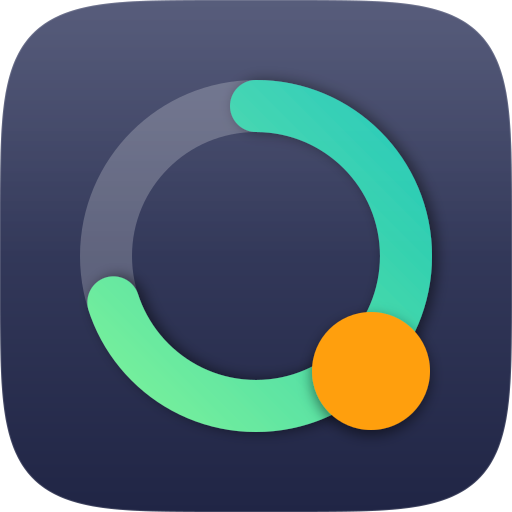

<p align="center">
  
</p>

<h1 align="center">Claude Ring</h1>

<p align="center">
  <samp>Claude usage limits and Claude Code status in your macOS menu bar</samp>
</p>

<p align="center">
  <a href="https://github.com/antonsiekmann/Claude-Ring/releases/latest"></a>
  
  
  <a href="LICENSE"></a>
</p>

[Deutsch](README.md)

A macOS menu bar app (macOS 26 or later) that shows how much of your Claude usage limit is left and
whether Claude Code is working right now. The app follows your system language (English or German).

> Claude Ring is an unofficial project and not affiliated with Anthropic. Claude and Claude Code are
> trademarks of Anthropic.

## Install

[**Download ClaudeRing.dmg**](https://github.com/antonsiekmann/Claude-Ring/releases/latest/download/ClaudeRing.dmg)
(latest version, Apple silicon and Intel), open it and drag “Claude Ring” onto “Programme”
(Applications); the disk image window shows where with an arrow. Older versions and changes are listed
under [Releases](https://github.com/antonsiekmann/Claude-Ring/releases).

Requirements: macOS 26 or later, Claude Code installed and signed in (run `claude` once in Terminal).

The app is ad-hoc signed, not notarized by Apple. So macOS blocks its first launch once: close the
message with “Done”, then go to **System Settings ▸ Privacy & Security ▸ Open Anyway** and confirm.
Alternatively, in Terminal: `xattr -dr com.apple.quarantine "/Applications/Claude Ring.app"`.

A **welcome window** then checks that Claude Code is signed in (and notices a sign-in in Terminal by
itself), sets up the status dot and the login item with one click and finally shows where the icon
sits in the menu bar. If the app was opened straight from the disk image, it offers to move it into
Applications. Open it again any time via **right-click ▸ Setup…** or **Settings ▸ General**.

## What it shows

- **Menu bar:** a ring with the share of the current 5-hour session that is left, next to the number,
  e.g. `◔ 87%`. Only the ring changes color: green, orange from the warning threshold, red from the
  critical threshold (80 and 95% used by default; the same thresholds trigger the notifications). In
  the middle of the ring sits a **status dot** for Claude Code:
  - purple, filled and pulsing: Claude Code is working (calm with Reduce Motion and in Low Power Mode)
  - light blue, half filled: Claude Code is waiting for your answer (a question or a permission)
  - green, a ring: idle
  - no dot: no Claude Code session is running

  Every state has its own shape, so it reads without color too. With several sessions, light blue wins
  over purple over green.
- **Popover (click):** a large ring for the session with a reset countdown, cards for the weekly limits,
  weekly usage by area and the running Claude Code sessions.
- **Menu (right-click):** Settings…, Refresh Now, Check for Updates…, Setup…, Quit.

## Where the data comes from

The app reads the OAuth token that **Claude Code** keeps in the keychain under
`Claude Code-credentials` and calls the endpoint Claude Code uses for `/usage`:

```
GET https://api.anthropic.com/api/oauth/usage
Authorization: Bearer <token>
anthropic-beta: oauth-2025-04-20
```

It reads the token through `/usr/bin/security`, the tool Claude Code creates the item with, so macOS
doesn't ask for your keychain password. The token stays in memory only and never shows up in logs; the
app never stores, changes or renews it. When it expires, running `claude` once is enough: the app
checks the keychain every 30 seconds (without asking Anthropic) and fetches as soon as the sign-in is
back.

Anthropic limits `/api/oauth/usage` strictly and sometimes answers HTTP 429 for a long time. Claude
Ring then waits 5 to 30 minutes, honors `Retry-After` and shows the last data with a calm hint. A “!”
in the menu bar only appears when you can do something, or when the data is older than 15 minutes.

## Claude Code status

The status dot needs a small hook. Set it up in the welcome window, in **Settings ▸ Menu Bar** or in
**Settings ▸ Claude Code ▸ Set Up**. The app

1. creates `~/Library/Application Support/ClaudeRing/claude-ring-hook.sh`,
2. backs up `~/.claude/settings.json` once, before its first change, to
   `…/ClaudeRing/Backups/settings-original.json` (never replaced),
3. registers the script as a hook for a few events. All other settings and hooks, their order and the
   file's format stay exactly as they were.

The script writes one small file per session to `…/ClaudeRing/Sessions/` with only the event, session
ID, project folder, tool name and session kind, never any input or content. It prints nothing and
always exits successfully, so it can't disturb Claude Code. “Remove” takes everything out again.

## Updates

Shortly after launch and then once a day, the app asks GitHub for the latest release (no account, no
data about you). If there is a newer version, the popover and the settings show it; nothing is
downloaded until you click **Install**. The app checks the download against GitHub's SHA-256 checksum,
verifies the app inside (bundle ID, version, intact signature, macOS version), replaces itself and
restarts. Settings, hooks and the login item stay as they are. Only an app in Applications can replace
itself.

## Remove completely

**Settings ▸ General ▸ Remove Claude Ring completely** removes everything the app created: the hook
entries in `~/.claude/settings.json` (nothing else in it changes), `~/Library/Application
Support/ClaudeRing`, the preferences, the login item and delivered notifications, caches and leftovers
of interrupted updates, and the app itself if it is in Applications (to the Trash). Claude Code and its
sign-in are never touched.

## Development

Open `ClaudeRing.xcodeproj` in Xcode and run with ⌘R. Tests: ⌘U or

```
xcodebuild -project ClaudeRing.xcodeproj -scheme ClaudeRing -destination 'platform=macOS' test
```

German is the source language; the English texts live in `ClaudeRing/Localizable.xcstrings`. A test
fails while any entry lacks its English text.

| Script | Purpose |
|---|---|
| `scripts/install.sh` | Builds a release version and installs it to `/Applications/Claude Ring.app`. |
| `scripts/make-dmg.sh` | Builds the universal version and `build/dist/ClaudeRing-<version>.dmg` with a background picture (dmgbuild, pinned with checksums), then checks the DMG the way the update function opens it. |
| `scripts/release-notes.sh` | Prints the `CHANGELOG.md` section for a version; the release job uses it as the release page text. |

A release is a git tag `vMAJOR.MINOR.PATCH` with a matching section in `CHANGELOG.md`; GitHub Actions
runs the tests, builds the DMG and publishes the release.

## License

Copyright © 2026 Anton Siekmann

Claude Ring is free software under the [GNU General Public License v3.0](LICENSE).
